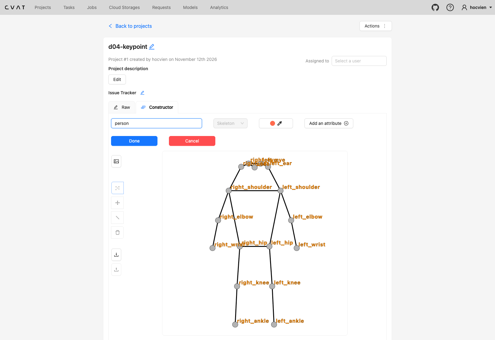
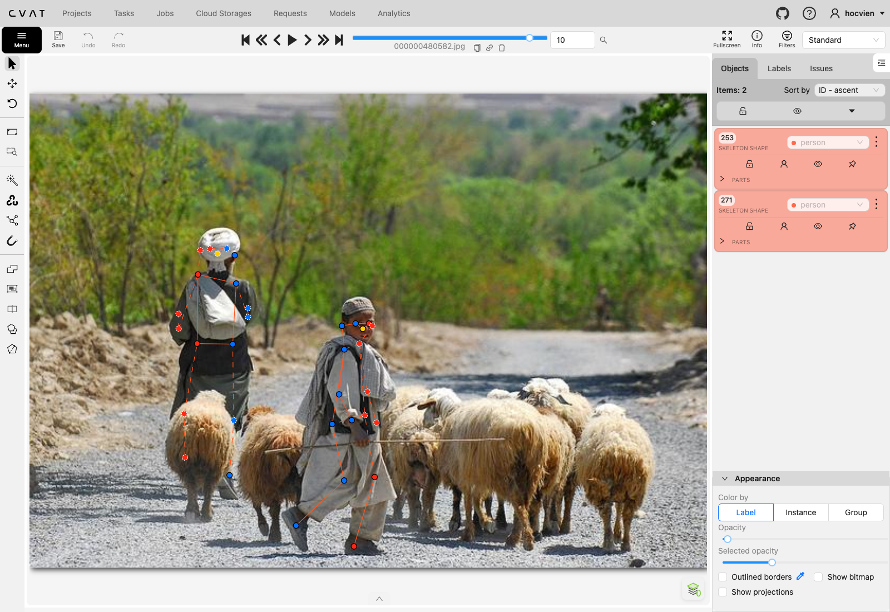
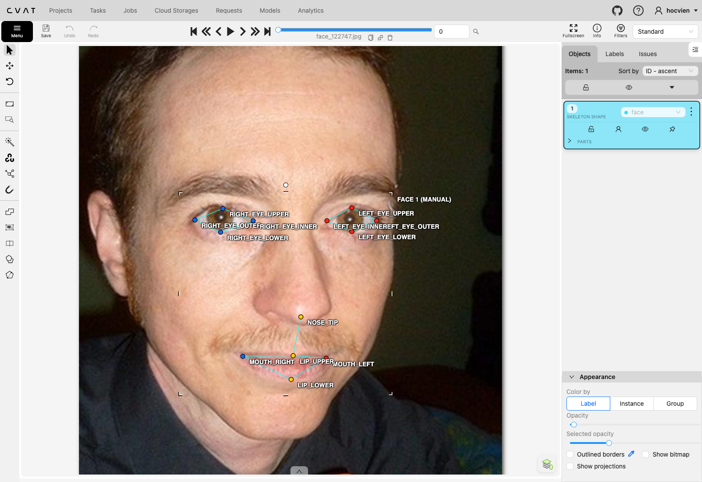
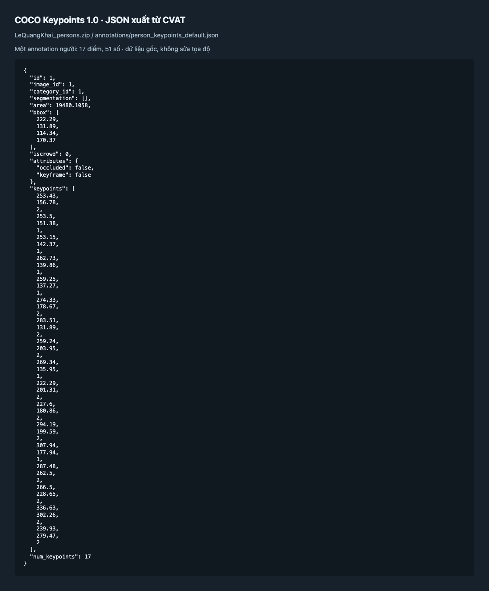

# Báo cáo cá nhân — LeQuangKhai · 2A202603237

Dữ liệu: bộ ảnh COCO 2017 được chia theo MSSV trong `src/exports/assignment.json`.

## 0. Thông tin học viên

- Họ tên: LeQuangKhai.
- MSSV: 2A202603237.
- Email: lqkhai2512@gmail.com.
- Link repository: https://github.com/kasdie/K5-L2-DAY04-LeQuangKhai-2A202603237-KeypointPose.
- Phiên bản CVAT: 2.74.1, chạy Docker tại `http://localhost:8080`.
- Máy: macOS 26.5.2 · RAM 16 GB.
- Bộ ảnh: có `src/exports/assignment.json`, dùng đúng MSSV và bộ ảnh được chia.
- Thời gian gán nhãn do học viên cung cấp: 17:30–19:30 ngày 12/11/2026, tổng 120 phút. Phần rà soát và đóng gói được thực hiện sau đó.
- Không ghi riêng thời gian của từng checkpoint/nhóm ảnh; không suy thời gian làm bài từ ngày tạo task.

## 1. Kiểm tra label (CP0)

| Label | Kiểu | Số điểm | Tên điểm đúng bảng của lab? | Đúng thứ tự? | Số cạnh |
|---|---|---:|---|---|---:|
| `person` | Skeleton | 17 | Có | Có | 19 |
| `face` | Skeleton | 13 | Có | Có | 13 |

Mẫu `person` dựng theo người quay mặt về camera: các điểm `left_*` nằm bên phải khung mẫu. Tên, thứ tự điểm và tập cạnh đã được đối chiếu với `src/keypoint_schema.json`.

Cách đổi cờ cho một điểm: rê chuột đúng điểm rồi bấm `Q` để bật/tắt `occluded`, `O` để bật/tắt `outside`; kiểm tra lại điểm đang được chọn và lưu bằng `Ctrl+S`. Không dùng `H` thay cho cờ visibility.

## 2. Số lượng đã gán và thời gian (CP1, CP2)

| Nhóm ảnh | Số ảnh được giao | Số skeleton đã lưu | Ghi chú | Thời gian riêng |
|---|---:|---:|---|---|
| `easy` | 5 | 5 | Mỗi ảnh một người | Không ghi riêng |
| `occluded` | 3 | 6 | Mỗi ảnh hai người | Không ghi riêng |
| `back` | 2 | 4 | Đã bổ sung người bị cắt ở mép phải ảnh `000000518966.jpg` | Không ghi riêng |
| `small` | 1 | 0 | Frame 5, `000000323705.jpg`: mentor cho phép bỏ theo thông tin học viên | Không ghi riêng |
| `crowd` | 1 | 3 | Ba người trong ảnh bóng chày | Không ghi riêng |
| `faces` | 8 | 8 | Mỗi ảnh một skeleton 13 điểm | Không ghi riêng |

- Tổng: 12 ảnh người vẫn được giữ trong task/file xuất, có 18 skeleton; 8 ảnh mặt có 8 skeleton.
- Không xóa frame 5 khỏi assignment hoặc sửa bộ ảnh được chia. Ảnh này không gán theo ngoại lệ mentor đã hướng dẫn.
- Không có thống kê riêng số người dưới 60 px hoặc số poster/gương/màn hình; không mặc định các số này bằng 0.
- Số ảnh đã xong đúng tại mốc phút 105: không ghi lại.
- Thời gian từng CP1/CP2/CP3 và ảnh tốn thời gian nhất: không ghi riêng. Ca khó học viên nêu là người xoay ngang, khiến các bộ phận hai bên chồng lên nhau.

## 3. Bảng ca khó (CP1, CP2)

Nội dung từ ghi chú của học viên, được hỗ trợ chỉnh câu chữ: ở “frame 1”, người xoay ngang thay vì quay mặt hoặc quay lưng thẳng về camera, nên một số khớp hai bên gần như xếp trên cùng một đường và chồng lên nhau. Khi rà lại cần lần theo từng chi từ vai hoặc hông, giữ trái/phải theo chính người trong ảnh thay vì suy từ bên trái/phải màn hình. Với điểm bị che, chỉ dùng `v=1` khi xác định được vị trí đủ chắc; nếu không xác định được thì dùng `v=0`.

| Ảnh | Người / mặt | Điểm | Cờ đã chọn | Phân vân giữa | Lý do / lưu ý |
|---|---|---|---|---|---|
| “Frame 1” theo cách gọi của học viên | Người xoay ngang | Các cặp khớp trái/phải chồng lên nhau | Đặt riêng theo tình trạng từng điểm: thấy `v=2`, bị che nhưng xác định được `v=1` | Thấy rõ / bị che; `v=1` / `v=0` khi không chắc vị trí | Theo dõi từng chi, kiểm tên trái/phải và đường nối; không dùng sự trùng nhau trên ảnh để gộp hai khớp |

CVAT đánh số frame từ 0. Ghi chú trên giữ cách gọi học viên cung cấp, không tự suy tên file khi học viên chưa nêu.

## 4. Bảng tự review (CP3)

Bảng dưới được tổng hợp có hỗ trợ đối chiếu nhãn đã lưu trên CVAT và lịch sử sửa trong buổi; không thay thế kết quả đối chiếu ground truth. Những dòng `ok` ghi nhận chưa phát hiện bất thường trong phạm vi kiểm tra nêu ở cột ghi chú.

| Ảnh | Người / mặt | Điểm | Mã lỗi | Ghi chú | Đã sửa? |
|---|---|---|---|---|---|
| `000000012552.jpg` — frame 0, `crowd` | Người bắt bóng, shape 1400 | Mũi và hai mắt | `vis_flag` | Ban đầu để `v=2` dù người quay lưng; đã đổi thành `occluded`, `v=1`. Chỉ giữ `v=1` nếu xác định vị trí đủ chắc | Có; thay đổi đã lưu trên CVAT |
| `000000518966.jpg` — frame 11, `back` | Người áo trắng ở mép phải | Cả skeleton | `missing` | Ban đầu chỉ có người bên trái; đã bổ sung người bị cắt ở mép phải. Ảnh hiện có hai skeleton | Có |
| `000000480582.jpg` — frame 10, `back` | Hai người đi cùng đàn cừu | Skeleton và cờ | `ok` | Đã đối chiếu hai skeleton riêng, tên trái/phải theo hướng người; kiểm các điểm `occluded` và giới hạn tọa độ | Không phát hiện lỗi trong phạm vi kiểm tra |
| `000000336477.jpg` — frame 6, `easy` | Trẻ em đứng trước nhà | Cả skeleton | `missing` | Ảnh trước đó chưa có nhãn; đã bổ sung một skeleton đủ 17 điểm | Có |
| `000000302102.jpg` — frame 4, `occluded` | Hai người cầm ván | Hai skeleton và cờ | `ok` | Có hai skeleton riêng; không gộp chi giữa hai người, không phát hiện điểm vượt khung | Không phát hiện lỗi trong phạm vi kiểm tra |
| `face_122747.jpg` — frame 0 | Mặt thẳng | Mắt và miệng trái/phải | `ok` | Đủ 13 điểm; `left_eye_*` và `mouth_left` ở bên phải ảnh theo người nhìn về camera | Không phát hiện đảo trái/phải rõ ràng |
| `face_324513.jpg` — frame 4 | Người đeo kính râm | Tám điểm mắt | `ok` | Tám điểm mắt sau tròng kính đều `occluded`, xuất thành `v=1` | Không phát hiện lỗi cờ ở tám điểm này |
| `face_504911.jpg` — frame 7 | Người đeo kính trong | Điểm mắt và bộ 13 điểm | `ok` | Đủ 13 điểm; `right_eye_inner` đang `occluded`, các điểm còn lại bình thường; không phát hiện đảo khóe hoặc mí qua kiểm tra hình học | Không phát hiện lỗi trong phạm vi kiểm tra |

Tổng hợp tám dòng trên:

| `lr_swap` | `vis_flag` | `position` | `missing` | `extra` | `ok` |
|---:|---:|---:|---:|---:|---:|
| 0 xác nhận | 1 | 0 xác nhận | 2 | 0 xác nhận | 5 |

Đoạn review tổng hợp: Qua các lần rà soát, phần cần cải thiện của bài là tránh bỏ sót người, đặc biệt người bị cắt ở mép ảnh, và đặt đúng cờ cho các điểm mặt không nhìn thấy. Tôi đã bổ sung người còn thiếu ở frame 6 và frame 11, đồng thời sửa cờ mắt/mũi ở frame 0. Với người xoay ngang, các khớp trái/phải có thể chồng lên nhau nên cần lần theo từng chi và kiểm tên điểm, không chỉ nhìn hình dạng đường nối. Trước khi xuất, cần lưu nhãn rồi kiểm lại cả số skeleton và cờ visibility trong JSON.

Điểm còn cần phân biệt `v=1`/`v=0`: vị trí bị che chỉ giữ `v=1` khi xác định chắc. Người bị cắt khung ở frame 11 có các điểm `outside`; file xuất có một annotation chỉ còn 7 điểm `v>0`. Không kéo điểm ngoài ảnh về mép để thay cho khớp không có trong khung.

Cảnh báo cổ chân của người đánh bóng ở frame 0 được ghi riêng ở mục 5 vì kiểm tra hình học chưa đủ để xác nhận lỗi `lr_swap`.

## 5. Kiểm file xuất và kết quả tự kiểm (CP4)

- Hai file được xuất từ chính task `persons-LeQuangKhai` (#26) và `faces-LeQuangKhai` (#27) bằng exporter **COCO Keypoints 1.0** của CVAT, `Save images` tắt.
- Giữ nguyên JSON trong ZIP; không sửa tay tọa độ, cờ hay số lượng điểm.
- Hai job chính #25 và #26 đã chuyển sang `completed`; hai job bonus #27 và #28 cũng đã hoàn thành.

Đọc mẫu trong JSON xuất thực:

| File | Người / mặt kiểm | Số phần tử `keypoints` | Kiểm cờ | `num_keypoints` |
|---|---|---:|---|---|
| `LeQuangKhai_persons.zip` | `000000012552.jpg`, annotation 1 | 51 | 11 điểm `v=2`, 6 điểm `v=1` | 17, khớp |
| `LeQuangKhai_persons.zip` | `000000518966.jpg`, annotation 18, người bị cắt ở mép phải | 51 | 10 điểm `v=0`, 3 điểm `v=1`, 4 điểm `v=2` | 7, khớp |
| `LeQuangKhai_faces.zip` | `face_324513.jpg`, annotation 5, kính râm | 39 | 8 điểm mắt `v=1`, 5 điểm còn lại `v=2` | 13, khớp |

`occluded` xuất thành `v=1`, `outside` xuất thành `v=0`. Trong bản CVAT này, 10 điểm `outside` vẫn mang tọa độ cũ; không sửa tay về `0,0`. `num_keypoints` được kiểm bằng số bộ ba có `v>0`.

Kết quả chạy `src/check_submission.py` trên hai ZIP:

```text
- File person: LeQuangKhai_persons.zip
  Số ảnh: 12 · số skeleton `person`: 18 · mỗi annotation 51 số
  Skeleton theo ảnh: 000000012552=3, 000000072098=1, 000000164659=1, 000000176000=1, 000000302102=2, 000000323705=0, 000000336477=1, 000000463932=1, 000000467300=2, 000000469061=2, 000000480582=2, 000000518966=2
  Cờ v: v=2 219 (72%) · v=1 77 (25%) · v=0 10 (3%)
  num_keypoints trung bình: 16.4
- File face: LeQuangKhai_faces.zip
  Số ảnh: 8 · số skeleton `face`: 8 · mỗi annotation 39 số
  Skeleton theo ảnh: face_122747=1, face_137371=1, face_159828=1, face_257657=1, face_324513=1, face_416730=1, face_425647=1, face_504911=1
  Cờ v: v=2 95 (91%) · v=1 9 (9%) · v=0 0 (0%)
  num_keypoints trung bình: 13.0
- Ghi chú: 10 điểm v = 0 vẫn mang tọa độ cũ (CVAT 2.x xuất như vậy; chuẩn COCO ghi 0, 0). Không phải lỗi: điểm v = 0 bị bỏ qua khi huấn luyện và khi chấm.
- Số [LỖI]: 0 · số [CẢNH BÁO]: 2
Kết quả: ĐẠT (đọc lại từng cảnh báo ở trên)
```

Các cảnh báo còn giữ nguyên:

1. `000000323705.jpg` không có skeleton: frame 5 được mentor cho phép bỏ theo thông tin học viên. Ảnh và assignment vẫn giữ nguyên.
2. `000000012552.jpg`, annotation 1: cặp `ankle` khác phía các cặp khác. Đây là cảnh báo hình học có thể xuất hiện do tư thế vận động; chưa có ground truth để kết luận đổi trái/phải. Giữ nguyên nhãn đang lưu, không tự hoán đổi chỉ để làm mất cảnh báo; cần đối chiếu tư thế/trao đổi mentor nếu còn phân vân.

Script ĐẠT xác nhận định dạng và các quy tắc kiểm tra của script, không bảo đảm mọi tọa độ đúng khớp hoặc đạt OKS cụ thể.

## 6. Ảnh chụp màn hình

1. Label `person` trong constructor của CVAT:

   

2. Ảnh người quay lưng đã gán trong job:

   

3. Mặt có đủ 13 điểm, phóng to vùng mắt:

   

4. Một annotation trong JSON xuất thực:

   

Nguồn: COCO 2017 theo bộ ảnh của repo lab; ảnh chụp giao diện CVAT local và nội dung file xuất của bài.

## 7. Tự đánh giá

1. Qua các lỗi đã được tìm và sửa, điểm cần chú ý nhất là bỏ sót người ở rìa ảnh và nhầm giữa điểm nhìn thấy với điểm chỉ ước lượng được. Lần sau cần đếm người trước khi gán, rà lần lượt bốn mép ảnh, rồi kiểm từng cờ sau khi đặt tọa độ. Khi người xoay ngang, cần lần theo chi từ vai/hông để tránh nhầm bên.
2. Quy tắc đề xuất bổ sung: trước khi kết thúc mỗi ảnh, quét bốn mép ảnh để tìm người bị cắt khung; với mỗi người, kiểm riêng những điểm bị che hoặc ngoài ảnh trước khi lưu. Đây là bước kiểm bổ sung được rút ra từ việc thiếu người ở frame 11.
3. Nhãn đi vào mục tiêu heatmap của model pose. Điểm `v=0` được bỏ khỏi phần giám sát keypoint; điểm `v=1` và `v=2` vẫn có thể được dùng để học vị trí. Nếu gán một khớp ngoài ảnh vào mép ảnh và để `v>0`, model có thể học một đỉnh heatmap sai. Việc dùng đúng `outside` ở người bị cắt khung giúp tránh tạo mục tiêu vị trí không có căn cứ. Chỉ đổi `v=2` sang `v=1` không có nghĩa là điểm đó tự động bị loại khỏi loss.

Các đoạn tổng hợp được hỗ trợ viết từ dữ liệu CVAT đã kiểm và ghi chú học viên cung cấp; không có đánh giá OKS hoặc cam kết độ chính xác từng pixel.

## 8. Khó khăn và lỗi kỹ thuật

- Khi nhập mật khẩu CVAT trong Terminal, ký tự không hiện nên ban đầu tưởng không nhập được; đây là cơ chế ẩn mật khẩu của `getpass`, nhập xong bấm Enter.
- Có lần job mặt chưa có nhãn trên server dù học viên đã thao tác; sau khi `Ctrl+S`, kiểm lại đã có đủ 8 skeleton. Vì vậy cần chờ lưu xong trước khi kiểm số lượng hoặc xuất file.
- Frame 5 được mentor cho bỏ; không tự đổi MSSV, xóa ảnh khỏi assignment hoặc sửa JSON để che cảnh báo.

## Bonus

### B1 — 3 ảnh người khó thêm

Task `persons-extra-LeQuangKhai` (#28), job #27. Đã gán đủ 3 ảnh, có 7 skeleton `person`, mỗi skeleton 17 điểm. Job đã chuyển `completed`. Số người dưới 60 px không được thống kê riêng, không tự suy bằng 0.

| Ảnh | Số skeleton | Số điểm `outside` | Ca cần chú ý khi đối chiếu |
|---|---:|---:|---|
| `000000254060.jpg` | 2 | 0 | Hai người trên xe máy chồng lên nhau; cần tách từng chi và cờ bị che. |
| `000000507223.jpg` | 3 | 4 | Ba người trong cảnh bóng chày, có người cúi và chân bắt chéo; còn hai cảnh báo hình học được ghi bên dưới. |
| `000000517702.jpg` | 2 | 0 | Hai người quay lưng, ô che vùng đầu; kiểm trái/phải và độ chắc khi đặt điểm bị che. |

File nộp: `src/exports/LeQuangKhai_bonus_persons.zip`, xuất COCO Keypoints 1.0 từ CVAT, không kèm ảnh và không sửa JSON bằng tay.

```text
- File person: LeQuangKhai_bonus_persons.zip
  Số ảnh: 3 · số skeleton `person`: 7 · mỗi annotation 51 số
  Skeleton theo ảnh: 000000254060=2, 000000507223=3, 000000517702=2
  Cờ v: v=2 88 (74%) · v=1 27 (23%) · v=0 4 (3%)
  num_keypoints trung bình: 16.4
- Ghi chú: 4 điểm v = 0 vẫn mang tọa độ cũ (CVAT 2.x xuất như vậy; chuẩn COCO ghi 0, 0). Không phải lỗi: điểm v = 0 bị bỏ qua khi huấn luyện và khi chấm.
- Số [LỖI]: 0 · số [CẢNH BÁO]: 2
Kết quả: ĐẠT (đọc lại từng cảnh báo ở trên)
```

Hai cảnh báo đều ở `000000507223.jpg`: skeleton #1 trong ảnh (COCO annotation id 3) có các cặp mắt/tai khác phía phần thân; skeleton #3 trong ảnh (COCO annotation id 5) có cặp cổ chân khác phía các cặp còn lại. Đã đối chiếu ảnh: có người quay đầu/cúi người và người đánh bóng đứng bắt chéo chân. Các cảnh báo này là heuristic hình học, chưa đủ để kết luận `lr_swap`; giữ nguyên nhãn học viên đã gán và ghi rõ để coach đối chiếu. Không khẳng định mọi điểm đúng ground truth hoặc tự chấm điểm bonus.

### B2 — 5 ảnh khuôn mặt đen trắng / hồng ngoại

Task `faces-extra-LeQuangKhai` (#29), job #28. Đủ 5/5 mặt, mỗi mặt một skeleton 13 điểm; job đã chuyển `completed`.

| Ảnh | Số skeleton | Số điểm mỗi skeleton | Số điểm `occluded` |
|---|---:|---:|---:|
| `face_274219.jpg` | 1 | 13 | 0 |
| `face_296417.jpg` | 1 | 13 | 0 |
| `face_300200.jpg` | 1 | 13 | 0 |
| `face_45276.jpg` | 1 | 13 | 0 |
| `face_68290.jpg` | 1 | 13 | 4 |

File nộp: `src/exports/LeQuangKhai_bonus_faces.zip`.

Nhận xét: ảnh đen trắng hoặc ảnh cũ thiếu manh mối màu để phân biệt da, mép mí và môi; vùng tối, nếp nhăn, râu/ria dễ làm khóe mắt hoặc viền môi không rõ. Trong bộ này, `face_68290.jpg` có râu che vùng miệng: bốn điểm miệng được đặt `occluded`, còn các điểm nhìn thấy giữ bình thường. Cần phóng to và dựa vào mép thật của mí/môi thay vì viền bóng hoặc râu.

Với kính râm trên ảnh hồng ngoại, không mặc định luôn `v=1`: nếu nhìn thấy điểm trong chính ảnh đang gán thì `v=2`; không thấy nhưng ước lượng chắc thì `v=1`; không xác định được hoặc ngoài ảnh thì `v=0`. Ảnh đen trắng không đồng nghĩa là ảnh hồng ngoại; quyết định dựa trên khả năng nhìn thấy từng điểm, không dựa riêng vào tên loại kính.

```text
- File face: LeQuangKhai_bonus_faces.zip
  Số ảnh: 5 · số skeleton `face`: 5 · mỗi annotation 39 số
  Skeleton theo ảnh: face_274219=1, face_296417=1, face_300200=1, face_45276=1, face_68290=1
  Cờ v: v=2 61 (94%) · v=1 4 (6%) · v=0 0 (0%)
  num_keypoints trung bình: 13.0
- Số [LỖI]: 0 · số [CẢNH BÁO]: 0
Kết quả: ĐẠT
```

### B3 — Model so với nhãn

Không đăng ký B3 trong bài nộp này; không dùng kết quả từ tool thử nghiệm riêng để tự nhận điểm B3.

Điểm B1/B2 do coach chấm theo rubric, tối đa 5 điểm mỗi mục và 10 điểm tổng bonus; không tự cộng vào điểm chính. Thời gian làm bonus không được học viên ghi riêng.

## 9. Tài liệu tham khảo và công cụ AI đã dùng

- Tài liệu trong repo: `RULES.md`, `CHECKPOINTS.md`, `docs/GUIDELINE.md`, `docs/CVAT_CHEATSHEET.md`, `docs/COCO_KEYPOINTS.md`, `RUBRIC.md`, `SUBMISSION.md`.
- CVAT local 2.74.1 và script `src/check_submission.py` của đề lab.
- ChatGPT/Codex: đọc và giải thích đề, hướng dẫn thao tác, hỗ trợ đối chiếu dữ liệu nhãn trên CVAT, tổng hợp bảng review và chỉnh báo cáo từ thông tin/ý của học viên, xuất và kiểm file, chụp minh chứng.
- Có xây dựng một tool MediaPipe riêng để thử nghiệm trong thư mục `day04`; các ZIP của bài chính trong repo được xuất từ hai task CVAT nêu ở mục 5.
